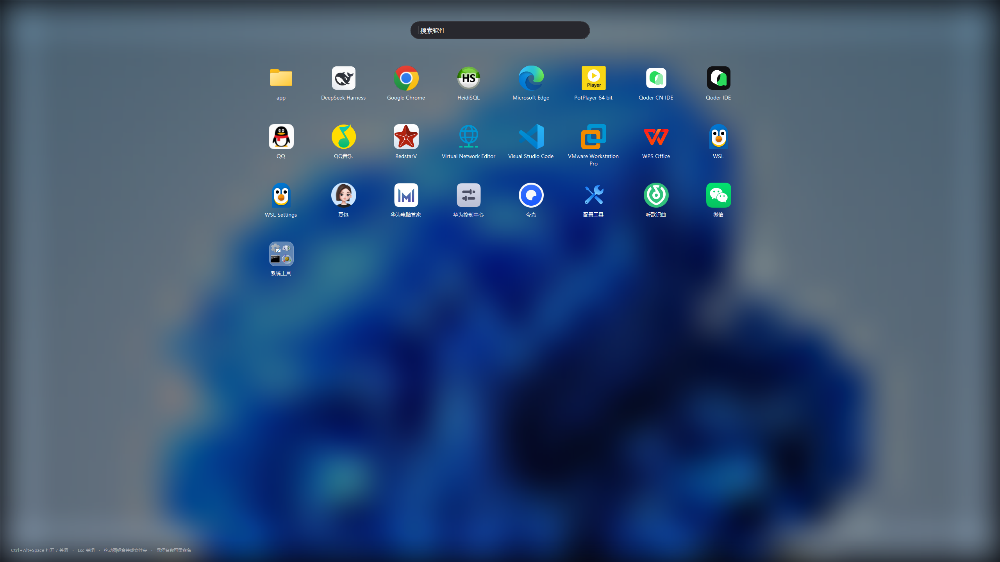

# Launchpad for Windows

把 Windows 做成 macOS Launchpad 那样：全屏铺开所有已安装软件的图标，点一下就启动；
图标可以互相拖动合并成文件夹，文件夹显示 2×2 缩略图。



## 打开方式

| 方式 | 说明 |
| --- | --- |
| 托盘图标（左键） | 启动后**只在系统托盘**里，任务栏不出现窗口；左键点托盘图标打开控制窗口 |
| `Ctrl + Alt + Space` | 全局热键，随时打开 / 关闭 |
| 双击 `Launchpad.exe` | 已在运行时会把面板叫出来 |

控制窗口没有底部按钮、也不占任务栏，直接点右上角 × 关闭：第一次会询问「退出程序」还是「收起到托盘」，
勾选「记住我的选择」后按你的选择执行，之后也可以在控制窗口的「关闭窗口时」里改。

## 控制面板里的设置

| 设置 | 说明 |
| --- | --- |
| 快捷键 | 点一下输入框，直接按下新的组合键即可录制（需带 Ctrl / Alt / Shift，F1–F12 可单独用）；冲突时会弹窗提示 |
| 顶层背景 | 类型二选一：纯色（默认）/ 自定义图片；选纯色时不显示图片控件，选图片时不显示取色控件 |
| 背景透明度 | 0–100%，遮罩层（图片或颜色）叠在深色底上的强度；默认纯色 80% |
| 关闭窗口时 | 每次询问 / 退出程序 / 收起到托盘；第一次点右上角 × 会弹窗让你选，可勾选记住 |
| Ctrl + 滚轮缩放 | 打开后，在面板里按住 Ctrl 滚动滚轮可放大 / 缩小图标（70%–180%，会记住） |
| 自定义应用 | 「添加…」选 exe / 快捷方式 / url，加入后出现在面板里；「删除」移除 |

## 图标

橙色鲸鱼：圆脑袋 + 左侧三条白色弧线 + 上翘的尾鳍 + 白色眼睛，身后三道浅橙色速度线表示“快速启动”。
**透明背景，没有底板**。`app.ico` 里带了 16/24/32/48/64/128/256 多个尺寸，构建时嵌进 exe，
所以任务栏、桌面快捷方式、托盘显示的都是它。


图标源码在 [tools/make-icon.ps1](tools/make-icon.ps1)，改完执行：

```powershell
powershell -NoProfile -ExecutionPolicy Bypass -File .\tools\make-icon.ps1
```

## 文件夹与排序

- **首次运行**会自动把 Windows 自带工具（命令提示符、控制面板、任务管理器、事件查看器…）
  收进一个叫「系统工具」的文件夹
- 按住一个图标拖到**另一个图标**上松手 → 在**那个图标的位置**新建文件夹，并立刻进入改名状态
- 拖到**已有文件夹**上松手 → 加进那个文件夹
- 文件夹里拖动图标 → 只在文件夹内部调整顺序；拖动过程中**弹层不会关闭**
- **松手在弹层外**才收起弹层并把图标移出到顶层：落到别的图标上建文件夹、拖进别的文件夹、
  落到缝隙插入到附近位置，落到网格外则追加到末尾
- 顶层空白处（含格子缝）点击 → 关闭面板
- 文件夹显示 2×2 缩略图；**点开后在屏幕中央展开一个圆角弹层**（不会占满整个全屏），
  弹层大小按图标数量计算，`Esc` 或点弹层外面收起
- 文件夹里右键 →「解散文件夹」，成员回到顶层
- 鼠标悬停在**文件夹名称**上，名称紧右侧出现铅笔图标，点它就地改名（Enter 确认 / Esc 取消）
- 打开文件夹后，**双击弹层顶部标题**也能直接改名；改名时点空白只提交、不关闭

顶层顺序保存在 `%APPDATA%\Launchpad\order.txt`，文件夹归属保存在 `folders.txt`。

## 其它操作

- 顶部搜索框输入即过滤：**顶层图标和所有文件夹里的图标都会命中**（不区分大小写，包含匹配）
- 滚轮 / `←` `→` 翻页（搜索框为空时方向键才翻页）
- `Esc` 关闭面板；点空白处也关闭
- 右键面板：刷新列表 / 开机启动 / 退出

## 它怎么工作

- **软件列表**：递归扫描开始菜单（`%ProgramData%\...\Start Menu\Programs` 和用户目录），
  过滤掉“卸载 / 帮助 / 更新”之类的快捷方式，按名称排序。
- **图标**：优先读快捷方式里记录的 `IconLocation`，用 `PrivateExtractIcons` 按 64×64 提取并保留透明通道；
  没有则退回目标程序的图标。
- **背景**：读注册表里的桌面壁纸路径，铺满屏幕后降采样再放大，得到模糊效果；没有壁纸就用深色渐变。
- **热键**：`RegisterHotKey` 注册 `Ctrl+Alt+Space`，单实例；第二次启动会通知已运行实例弹出面板。
- **文件夹**：`FolderStore` 用纯文本按 `F|id|名字` / `A|id|快捷方式路径` 记录，启动时和目录里的应用对上。

## 遇到 SmartScreen

exe 没有数字签名，Windows 可能提示「Windows 已保护你的电脑」：

- 点「更多信息」→「仍要运行」，或
- 右键 exe → 属性 → 勾选「解除锁定」，或
- `Unblock-File "C:\Users\yanbe\Desktop\redApple\Launchpad.exe"`

## 编译

```powershell
powershell -NoProfile -ExecutionPolicy Bypass -File .\build.ps1
```

直接调用系统自带的 `csc.exe`（.NET Framework 4.x），不需要 Visual Studio 或 dotnet SDK。

## 代码结构

| 文件 | 作用 |
| --- | --- |
| `src/Program.cs` | 入口、单实例、崩溃日志（error.log） |
| `src/LaunchpadContext.cs` | 常驻进程：热键、托盘、控制窗口、面板生命周期 |
| `src/LauncherWindow.cs` | 控制窗口（托盘左键打开，不占任务栏） |
| `src/HotkeyWindow.cs` | 接收 `WM_HOTKEY` 的隐藏窗口 |
| `src/LaunchpadForm.cs` | 全屏面板：模糊壁纸、搜索、图标网格、拖拽合并、分页 |
| `src/AppCatalog.cs` | 扫描开始菜单、过滤、排序 |
| `src/FolderStore.cs` | 文件夹数据与持久化、2×2 缩略图 |
| `src/ShellIcons.cs` | 64px 图标提取 |
| `src/Shortcut.cs` | 创建桌面快捷方式 |
| `src/Native.cs` | 热键、图标、壁纸相关 P/Invoke |
| `src/TrayIcon.cs` | 托盘图标（取 exe 内嵌图标） |
| `src/Startup.cs` | 开机启动 |

## 已知限制

- 部分 UWP 应用的图标会显示成通用图标
- 只覆盖主屏；多显示器 / 竖屏没有适配
- 文件夹不能重命名（先自动编号），暂不支持把图标拖出文件夹


